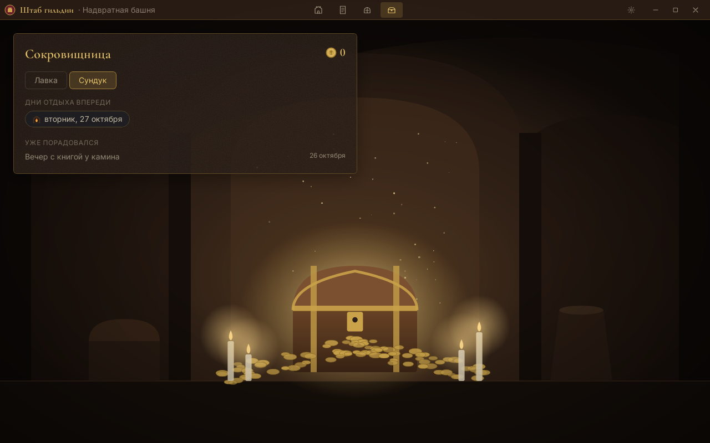
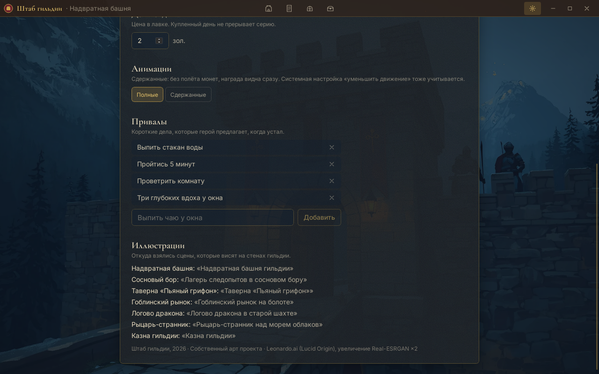
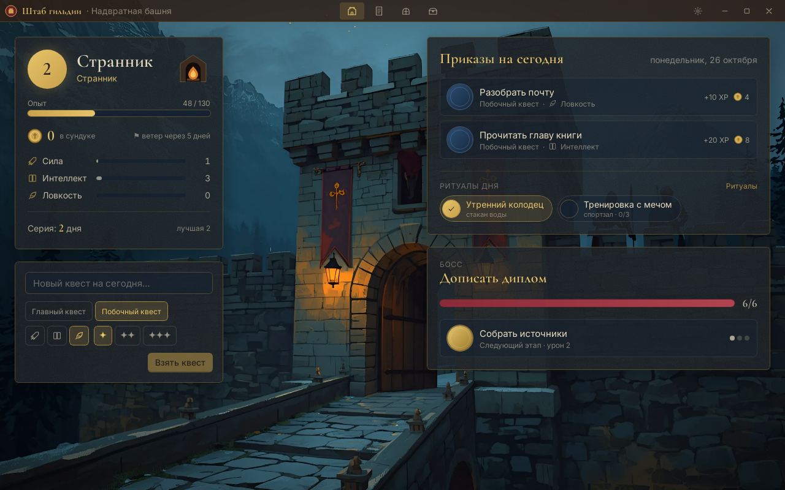
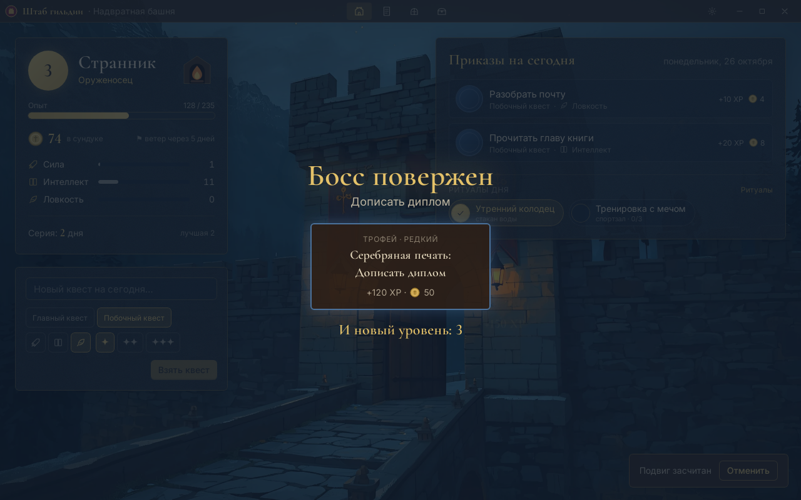
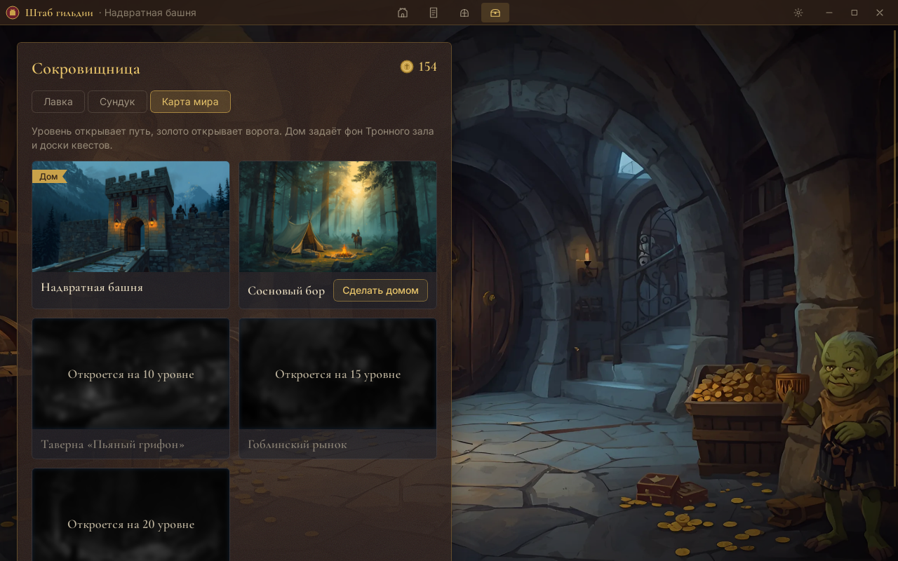
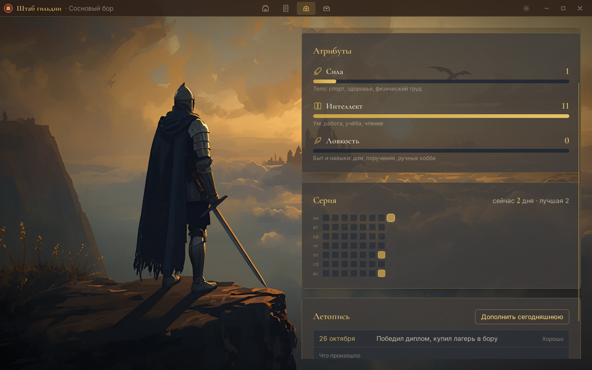

# Fantasy Planner

Персональный ежедневник-трекер-планировщик в фэнтези-стилистике. Десктопное приложение на Tauri v2 + React + TypeScript + SQLite.

Спецификации лежат в `specs/`, правила разработки в `CLAUDE.md`.

## Что уже есть

- **V0.1 «Первый дозор»:** квесты Main и Side, награды XP и золотом, уровни и атрибуты, серия дней с бонусом «Попутный ветер», мягкая усталость с привалом, отмена в течение дня.
- **V0.2 «Обеты и казна»:** ритуалы с гибким расписанием и паузой, лавка своих наград, сундук, покупка дня отдыха, экран настроек.
- **V0.3 «Карта мира»:** боссы с этапами и полосой HP, победа с трофеем, карта мира с покупкой локаций и сменой дома, хроника дня.

| Тронный зал и ритуалы | Сокровищница |
|---|---|
|  |  |
| **Сундук** | **Устав гильдии** |
|  |  |
| **Босс на главном экране** | **Босс повержен** |
|  |  |
| **Карта мира** | **Летопись** |
|  |  |

## Готовая сборка под Windows

Каждый PR и каждый коммит в `main` собирает установщик в GitHub Actions. Чтобы его скачать, открой вкладку **Actions**, выбери последний зелёный запуск **CI** и в блоке **Artifacts** возьми `shtab-gildii-windows`. В архиве лежит NSIS-установщик `.exe`.

Установщик не подписан, поэтому Windows SmartScreen при первом запуске предупредит о неизвестном издателе: «Подробнее» → «Выполнить в любом случае». WebView2 есть в Windows 10 и 11; если его нет, установщик скачает его сам.

## Запуск

Нужны Node.js 22+, pnpm 10+, Rust 1.90+ и системные зависимости Tauri v2 для своей ОС
(https://v2.tauri.app/start/prerequisites/).

```bash
pnpm install
pnpm tauri dev      # разработка
pnpm tauri build    # установщик в src-tauri/target/release/bundle
```

База лежит в каталоге данных приложения (`guild.db`), миграции применяются при старте.

## Проверки

```bash
pnpm typecheck && pnpm lint && pnpm test
cd src-tauri && cargo clippy --all-targets -- -D warnings && cargo test
```
