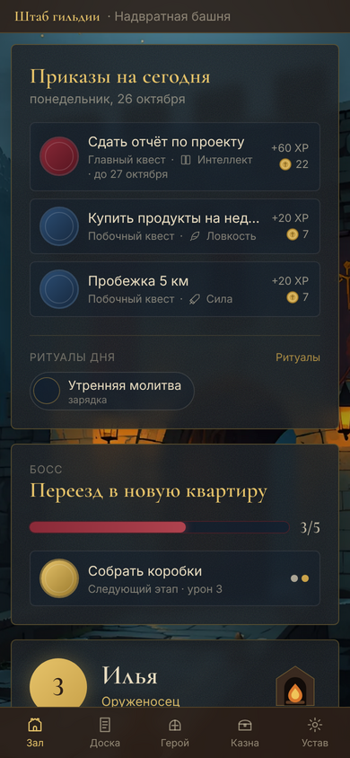
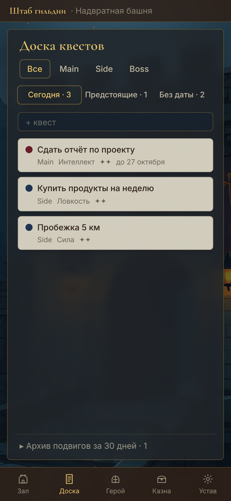
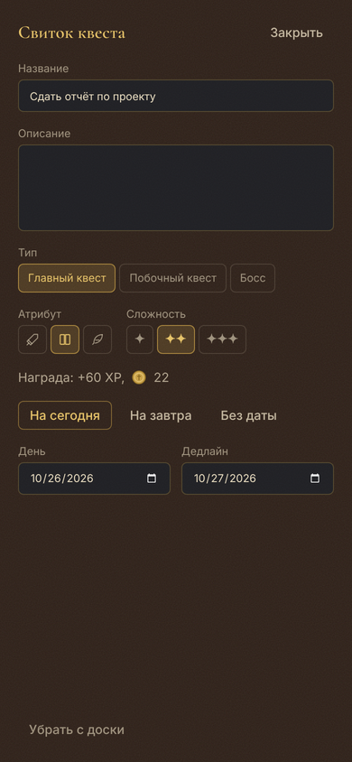

# Fantasy Planner

Персональный ежедневник-трекер-планировщик в фэнтези-стилистике. Приложение для Windows и Android на Tauri v2 + React + TypeScript + SQLite.

Спецификации лежат в `specs/`, правила разработки в `CLAUDE.md`.

## Что уже есть

- **V0.1 «Первый дозор»:** квесты Main и Side, награды XP и золотом, уровни и атрибуты, серия дней с бонусом «Попутный ветер», мягкая усталость с привалом, отмена в течение дня.
- **V0.2 «Обеты и казна»:** ритуалы с гибким расписанием и паузой, лавка своих наград, сундук, покупка дня отдыха, экран настроек.
- **V0.3 «Карта мира»:** боссы с этапами и полосой HP, победа с трофеем, карта мира с покупкой локаций и сменой дома, хроника дня.

| Тронный зал и ритуалы | Сокровищница |
|---|---|
|  |  |
| **Сундук** | **Устав гильдии** |
|  |  |
| **Босс на главном экране** | **Босс повержен** |
|  |  |
| **Карта мира** | **Летопись** |
|  |  |

На телефоне те же экраны идут одной колонкой, навигация внизу, доска квестов разбита на вкладки:

| Тронный зал | Доска квестов | Свиток квеста |
|---|---|---|
|  |  |  |

## Готовая сборка под Windows

Каждый PR и каждый коммит в `main` собирает установщик в GitHub Actions. Чтобы его скачать, открой вкладку **Actions**, выбери последний зелёный запуск **CI** и в блоке **Artifacts** возьми `shtab-gildii-windows`. В архиве лежит NSIS-установщик `.exe`.

Установщик не подписан, поэтому Windows SmartScreen при первом запуске предупредит о неизвестном издателе: «Подробнее» → «Выполнить в любом случае». WebView2 есть в Windows 10 и 11; если его нет, установщик скачает его сам.

## Готовая сборка под Android

Там же, в блоке **Artifacts** запуска **CI**, лежит `shtab-gildii-android` с файлом `.apk`. Скопируй его на телефон и открой. Android попросит разрешить установку из этого источника (браузера или файлового менеджера): разреши один раз. Новая сборка ставится поверх старой, данные сохраняются.

Чтобы обновления вставали поверх, APK подписывается постоянным ключом из секретов репозитория `ANDROID_KEYSTORE` (keystore в base64, псевдоним `guild`) и `ANDROID_KEYSTORE_PASSWORD`. Без них CI подписывает разовым ключом: такую сборку перед следующей придётся удалить вместе с данными.

На телефоне своя база, отдельная от ПК.

## Запуск

Нужны Node.js 22+, pnpm 10+, Rust 1.90+ и системные зависимости Tauri v2 для своей ОС
(https://v2.tauri.app/start/prerequisites/).

```bash
pnpm install
pnpm tauri dev      # разработка
pnpm tauri build    # установщик в src-tauri/target/release/bundle
```

Для Android дополнительно нужны JDK 17+, Android SDK и NDK (`ANDROID_HOME`, `NDK_HOME`) и Rust-цели `aarch64-linux-android`, `armv7-linux-androideabi`. Проект Android Studio лежит в `src-tauri/gen/android`.

```bash
pnpm tauri android dev                # на подключённом телефоне или эмуляторе
pnpm tauri android build --apk        # APK в src-tauri/gen/android/app/build/outputs/apk
```

База лежит в каталоге данных приложения (`guild.db`), миграции применяются при старте.

## Проверки

```bash
pnpm typecheck && pnpm lint && pnpm test
cd src-tauri && cargo clippy --all-targets -- -D warnings && cargo test
```
