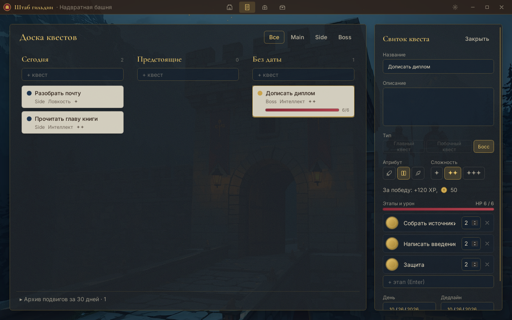

<div align="center">

# Штаб гильдии

**Фэнтези-ежедневник, трекер привычек и планировщик для Windows, macOS и Linux**

Дела становятся квестами, привычки ритуалами, большие проекты боссами.
За каждое дело герой получает опыт и золото, а золото тратится на настоящие награды, которые ты назначаешь себе сам.

[](https://github.com/IlyaLob0v/fantasy-planner/actions/workflows/ci.yml)


[](LICENSE)


</div>

## Содержание

- [Идея](#идея)
- [Возможности](#возможности)
- [Как устроены награды](#как-устроены-награды)
- [Скриншоты](#скриншоты)
- [Установка](#установка)
- [Сборка из исходников](#сборка-из-исходников)
- [Архитектура](#архитектура)
- [Структура репозитория](#структура-репозитория)
- [Дорожная карта](#дорожная-карта)
- [Авторы](#авторы)
- [Лицензия](#лицензия)

## Идея

Мотивация держится на петле «сделал → получил → увидел рост» и на эстетике. Поэтому в приложении:

- **Нет штрафов.** Золото и опыт никогда не отнимаются за бездействие. Пропущенный день только прерывает серию и включает мягкую «усталость», которую снимает одно любое дело.
- **Нет лишних кликов ради атмосферы.** Квест выполняется одним нажатием на печать, награда видна сразу, любая анимация пропускается кликом и длится не дольше двух секунд.
- **Всё хранится локально.** Данные лежат в SQLite-файле на твоём компьютере, без аккаунтов и облака.

## Возможности

### Квесты
- **Главные** (важное, с дедлайном) и **побочные** (рутина), три уровня сложности.
- Быстрое добавление на сегодня прямо с главного экрана: тип, атрибут и сложность двумя кликами.
- **Доска квестов** с колонками «Сегодня», «Предстоящие» и «Без даты», перетаскивание между ними, фильтры, архив подвигов за 30 дней.
- Отмена выполненного квеста до конца игровых суток.

### Боссы
- Крупный проект становится боссом с этапами. У каждого этапа свой урон, полоса HP показывает, сколько осталось.
- Карточка босса на главном экране: следующий этап выполняется прямо оттуда.
- Победа даёт отдельную награду и **трофей** в сундук. Редкость трофея зависит от размера босса: обычный, редкий, эпический или легендарный.

### Ритуалы
- Привычки с фэнтези-названием и реальным подзаголовком, например «Утренний колодец · стакан воды».
- Гибкое расписание: каждый день, по дням недели, N раз в неделю или раз в N дней. Ритуал можно поставить на паузу.

### Герой
- Опыт, уровни и титулы: от Странника до Владыки замка.
- Три атрибута: **Сила** (тело, спорт), **Интеллект** (работа, учёба, чтение), **Ловкость** (быт, поручения, ручные хобби).
- Серия дней с календарём за 8 недель.

### Казна и мир
- **Лавка своих наград**: вечер с книгой, поход в кино, новая настолка. Цену и многоразовость задаёшь ты.
- **День отдыха у камина**: покупается заранее и не прерывает серию.
- **Карта мира**: пять локаций открываются уровнем и покупаются золотом. Любую открытую можно сделать домом, и она станет фоном главного экрана.

### Хроника дня
- Вечером главный экран предлагает записать день: что произошло, что заметил, что чувствуешь, и настроение.
- Все записи собраны в «Летописи» на экране героя. За хронику нет наград: это дневник, а не обязанность.

## Как устроены награды

| Дело | Опыт | Золото |
|---|---|---|
| Побочный квест | 10 | 3 |
| Главный квест | 30 | 10 |
| Этап босса | 15 | 4 |
| Победа над боссом | 60 | 25 |
| Ритуал | 5 | 2 |
| Привал | 3 | 0 |

- Это базовые ставки за сложность ✦. Сложность ✦✦ и ✦✦✦ умножают их на 2 и 3. Все ставки меняются в настройках.
- Дело также прибавляет очки атрибуту, к которому относится.
- **Попутный ветер**: каждые 7 дней серии добавляют +10 % к золоту, максимум +30 %. Пропуск снижает бонус на одну ступень, а не обнуляет его.
- **Усталость**: если прошедший день остался без единого дела и не был днём отдыха, сцена погружается в сумерки, и герой просит привала. Одно любое дело возвращает свет.
- **Игровые сутки** начинаются в выбранный час (по умолчанию в 04:00), поэтому дело, сделанное после полуночи, засчитывается вчерашнему дню.
- Журнал наград (`ledger`) хранит каждое начисление. Отмена пишет обратную запись, а не стирает историю.

Подробности и обоснования решений собраны в [specs/plan.md](specs/plan.md).

## Скриншоты

| Тронный зал и ритуалы | Доска квестов: босс и этапы |
|---|---|
|  |  |
| **Босс повержен** | **Карта мира** |
|  |  |
| **Сокровищница** | **Сундук с трофеями** |
|  |  |
| **Герой и Летопись** | **Устав гильдии** |
|  |  |

## Установка

### Windows

Каждый коммит в `main` и каждый PR собирает установщик в GitHub Actions.

1. Открой [последние запуски CI](https://github.com/IlyaLob0v/fantasy-planner/actions/workflows/ci.yml?query=branch%3Amain+is%3Asuccess) и выбери верхний зелёный.
2. Внизу страницы, в блоке **Artifacts**, скачай `shtab-gildii-windows`.
3. Распакуй архив и запусти установщик `.exe`.

Установщик не подписан, поэтому Windows SmartScreen предупредит о неизвестном издателе: «Подробнее» → «Выполнить в любом случае». WebView2 уже есть в Windows 10 и 11; если его нет, установщик скачает его сам.

### macOS и Linux

Готовых сборок пока нет, приложение собирается из исходников (см. ниже).

### Где лежат данные

База `guild.db` хранится в каталоге данных приложения:

| ОС | Путь |
|---|---|
| Windows | `%APPDATA%\dev.ilyalob0v.fantasy-planner\` |
| macOS | `~/Library/Application Support/dev.ilyalob0v.fantasy-planner/` |
| Linux | `~/.local/share/dev.ilyalob0v.fantasy-planner/` |

Чтобы сделать резервную копию, достаточно скопировать этот файл при закрытом приложении.

## Сборка из исходников

Нужны Node.js 22+, pnpm 10+, Rust 1.90+ и [системные зависимости Tauri v2](https://v2.tauri.app/start/prerequisites/) для своей ОС.

```bash
pnpm install
pnpm tauri dev      # разработка с горячей перезагрузкой
pnpm tauri build    # установщик в src-tauri/target/release/bundle
```

Миграции базы применяются при каждом запуске до показа окна.

### Проверки

Те же проверки запускает CI на каждый PR:

```bash
pnpm typecheck && pnpm lint && pnpm test
cd src-tauri && cargo clippy --all-targets -- -D warnings && cargo test
```

## Архитектура

```
React-экраны  ──►  services (сценарии)  ──►  domain (чистые функции, тесты Vitest)
                         │
                         ▼
                 ipc (типизированный invoke)
                         │
                         ▼
          Rust-команды (тонкие: чтение, запись, транзакции)
                         │
                         ▼
                 SQLite через sqlx (WAL)
```

- **Вся логика игры живёт в TypeScript**, в `src/domain`. Это чистые функции, покрытые тестами: награды, уровни, серия, усталость, боссы, локации.
- **Rust-команды не знают правил игры.** Ход игрока TS считает целиком, а команда `commit_outcome` атомарно пишет его одной транзакцией: статусы квестов, отметку ритуала, предметы, журнал, сутки и кэш героя.
- **Журнал `ledger` является источником истины** для опыта, золота и атрибутов. Поля героя служат кэшем.
- **Миграции только добавляются**, уже применённый файл не редактируется.
- **Иллюстрации подключаются через единый реестр** `src/assets/registry.ts`: ключ → файл, точка кадрирования, цвета панелей и происхождение. Цвета интерфейса подстраиваются под сцену.

Стек: Tauri v2, Rust (sqlx, SQLite), React 19, TypeScript в режиме strict, Vite, Tailwind CSS 4, shadcn/ui и Radix, TanStack Query, Motion.

## Структура репозитория

```
fantasy-planner/
├── CLAUDE.md                 # правила разработки
├── specs/                    # план, схема БД, экраны, библия стиля: источник истины
├── docs/screenshots/         # скриншоты для README
├── src/
│   ├── app/                  # App, переключение экранов, строки интерфейса
│   ├── screens/              # Тронный зал, Доска квестов, Герой, Сокровищница, Устав
│   ├── components/kit/       # свой UI-кит: печати, ленты, панели, полосы XP и HP
│   ├── components/ui/        # базовые компоненты shadcn/ui под палитру проекта
│   ├── domain/               # правила игры и их тесты
│   ├── services/             # сценарии: выполнить квест, купить награду…
│   ├── ipc/                  # обёртки над Rust-командами
│   ├── theme/                # токены палитры и шрифты
│   └── assets/               # реестр и иллюстрации (WebP 2560 px)
└── src-tauri/
    ├── migrations/           # 0001_core, 0002_rituals_shop, 0003_chronicle_locations
    └── src/commands/         # тонкие команды по таблицам
```

| Документ | О чём |
|---|---|
| [specs/plan.md](specs/plan.md) | принятые решения и план версий |
| [specs/schema.md](specs/schema.md) | схема SQLite по миграциям |
| [specs/screens.md](specs/screens.md) | экраны и их поведение |
| [specs/art-bible.md](specs/art-bible.md) | стиль иллюстраций и промпты |
| [CLAUDE.md](CLAUDE.md) | правила архитектуры и кода |

## Дорожная карта

- [x] **V0.1 «Первый дозор»**: квесты, награды, уровни, серия, усталость и привал
- [x] **V0.2 «Обеты и казна»**: ритуалы, лавка наград, сундук, день отдыха, настройки
- [x] **V0.3 «Карта мира»**: боссы, трофеи, локации, хроника дня
- [x] Сборка установщика под Windows в CI
- [ ] Свой набор рамок, лент и печатей в стиле иллюстраций
- [ ] Иллюстрация для оверлея нового уровня
- [ ] Звуки (по желанию, выключены по умолчанию)

## Авторы

- **Илья** ([@IlyaLob0v](https://github.com/IlyaLob0v)): идея, геймдизайн, выбор и подготовка иллюстраций
- **Claude** (Anthropic): код, спецификации и документация по задачам Ильи

## Лицензия

Код распространяется по лицензии [MIT](LICENSE).

Иллюстрации в `src/assets/illustrations/` не входят в MIT: все права на них принадлежат автору проекта. Происхождение каждой сцены описано в [src/assets/illustrations/README.md](src/assets/illustrations/README.md).
